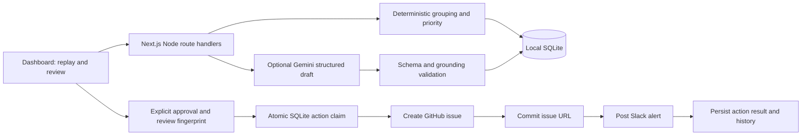
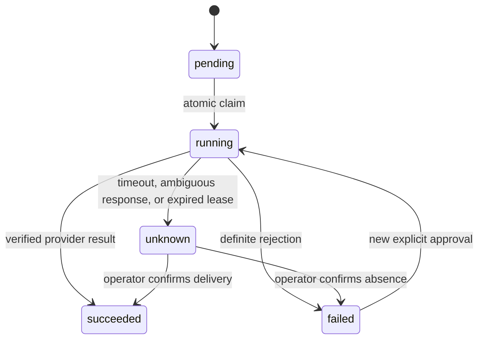

# Solution design

## Problem and outcome

Restaurant checkout failures are noisy: repeated events can exaggerate impact, and a store-specific printer problem should not look like a shared payment incident. This MVP turns repeatable synthetic events into a durable incident, a grounded triage draft, and a human-approved escalation trail.

## Modules

| Module                | Responsibility                                                                                             |
| --------------------- | ---------------------------------------------------------------------------------------------------------- |
| `lib/triage.ts`       | Synthetic fixtures, normalization-based grouping, deterministic incident IDs, distinct counts and priority |
| `lib/domain.ts`       | Shared data types, canonical fallback, grounded escalation payloads                                        |
| `lib/store.ts`        | SQLite schema, transaction boundaries, durable evidence, action claims, history and reconciliation         |
| `lib/gemini.ts`       | Server-invoked Gemini REST request and strict response validation                                          |
| `lib/escalation.ts`   | Ordered approval orchestration and injectable preview/mock providers                                       |
| `lib/providers.ts`    | Live HTTP adapters, destination checks and uncertainty classification                                      |
| `lib/server.ts`       | Server-only environment access, database singleton, local-origin check and review fingerprint              |
| `app/api/**/route.ts` | Validated request boundaries; all database handlers explicitly use Node runtime                            |
| `app/dashboard.tsx`   | Run controls, incident detail, evidence timeline, payload review, approval and reconciliation              |

## Detection and persistence

Each run stores its creation time, a five-minute-aligned anchor, and priority thresholds. The fixtures have stable event/attempt IDs relative to a run, so replay is reproducible even hours later. The burst sends seven records: six distinct attempts across two stores and one repeated event ID. Alternating `GATEWAY_TIMEOUT` and `gateway-timeout` demonstrates normalization. The isolated scenario uses two receipt-printer failures at one store.

Grouping uses fixed UTC windows rather than a sliding window. Error codes are trimmed, uppercased, and spaces/hyphens become underscores. A group key includes stage, normalized error, and window start; a hash of the run and group key gives a stable incident ID. Attempts are store-scoped. Five-minute boundary and repeated-attempt tests document these decisions.

SQLite stores:

- `runs`: run ID, creation time, anchor and rule snapshot.
- `events`: unique `(run_id, event_id)` and complete synthetic evidence.
- `incidents`: stable ID, run relationship, facts and validated draft.
- `actions`: unique `(incident_id, mode, provider)`, current state, attempt count, URL, destination identity and claim token.
- `history`: append-only attempt records, exact payload, timestamps and result; the active attempt is completed in place. Manual reconciliation adds a distinct record.

Replay inserts all fixture evidence and incidents in one transaction. Since the MVP exposes only complete, immutable fixtures, an incident's evidence does not grow incrementally. Supporting arbitrary incoming events would require updating group snapshots and explicit review invalidation. Starting a new run preserves all prior records. WAL and a busy timeout support concurrent local requests; data is kept outside `.next` and survives builds and restarts.

## AI scope and grounding

The backend is authoritative for counts, priority, stores, evidence and the window. Gemini receives these facts and selected synthetic evidence, without provider credentials or tools. Its structured response contains title, summary, impact counts, evidence references, unknowns and a first check.

For this short MVP, title/summary wording is constrained to fact-derived alternatives; evidence IDs must exist, impact counts must match exactly, and troubleshooting/unknowns come from curated choices. This deliberately trades open-ended prose for verifiable grounding. No causal diagnosis is asserted. Root cause remains explicitly unknown. A malformed response, wrong count, invented reference, API error or missing configuration falls back deterministically. Responses are validated before display or persistence. A summary cannot replace an incident draft once an escalation has started.

## Approval, partial failures and recovery

The browser cannot select mode or pass provider credentials. Same-origin loopback requests and explicit approval are required. The server fingerprints mode, destination identity and the current draft payload; stale approvals are rejected for a fresh review.

Each action transitions through:

`BEGIN IMMEDIATE` serializes claims across SQLite connections; no transaction spans a network request. A second request sees the existing claim and cannot send twice. GitHub succeeds and commits its URL before Slack is claimed. Repeated completed approvals reuse stored results. Slack failures retry Slack only. Preview and live states are independent.

Requests have a 15-second timeout. A running claim older than 60 seconds becomes unknown on refresh or approval; a late response cannot overwrite a recovered claim. There is no assertion of exactly-once delivery: providers can deliver even when the response is lost. Unknown outcomes require checking the destination and recording a human reconciliation. A confirmed existing GitHub issue URL must belong to the original demo repository. The UI previews the Slack payload with an issue-URL placeholder until the URL is known.

Webhook identities are stored as a one-way fingerprint plus the channel label, never the secret URL. Raw provider response bodies and exception strings are not surfaced as errors. A changed destination is blocked once an action was attempted. All action payloads contain synthetic incident data only.

## Verification and scope

Automated tests inject mocked HTTP clients; no live Gemini, GitHub or Slack calls are required. They cover detection, duplicate attempts/events, boundaries, configurable thresholds, fallback/grounding, provider ordering, retry, concurrent claims, uncertainty, reconciliation and reopening a file-backed database. Playwright exercises the complete preview flow on desktop/mobile and checks for horizontal overflow and browser exceptions.

The local application has no public authentication layer and binds to loopback. Cloud hosting, scheduler jobs, real POS ingestion and production incident lifecycle management are intentionally deferred. Source, this design, and a user-recorded walkthrough form the assignment package.

## Provider references

Implementation references: [Next.js route handlers](https://nextjs.org/docs/app/getting-started/route-handlers), [server environment loading](https://nextjs.org/docs/app/guides/environment-variables), [Node SQLite](https://nodejs.org/download/release/latest-v24.x/docs/api/sqlite.html), [Gemini structured output](https://ai.google.dev/gemini-api/docs/structured-output), [Gemini generation API](https://ai.google.dev/api/generate-content), [GitHub issue creation](https://docs.github.com/en/rest/issues/issues#create-an-issue), and [Slack incoming webhooks](https://docs.slack.dev/messaging/sending-messages-using-incoming-webhooks/).
